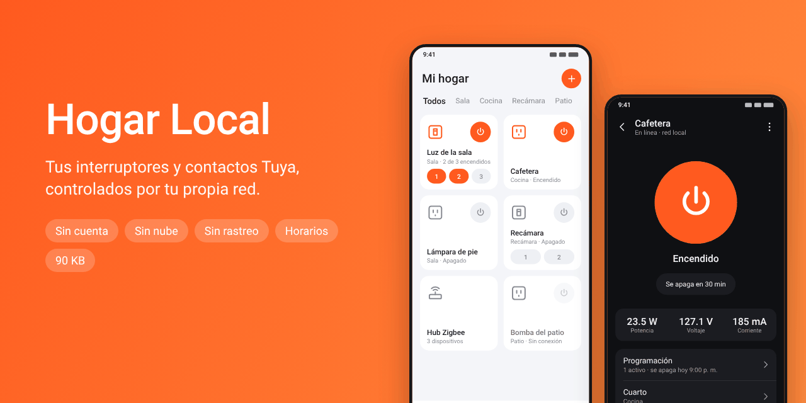
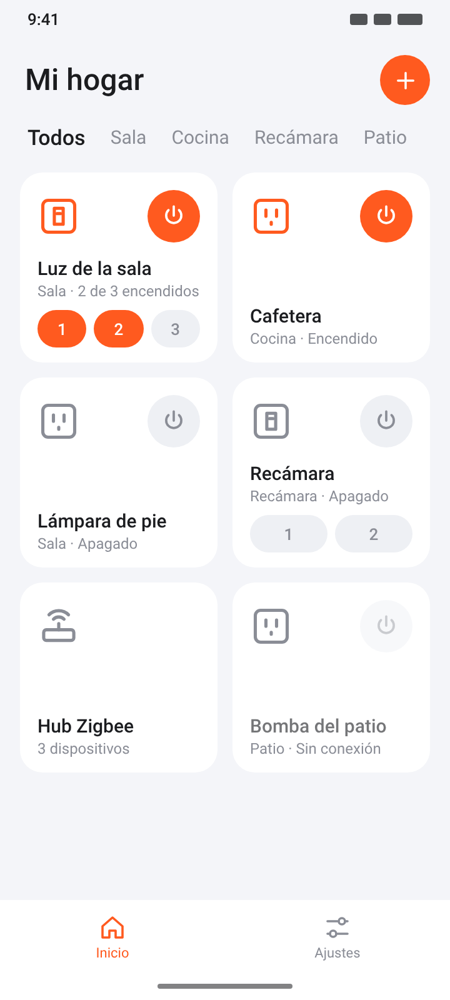
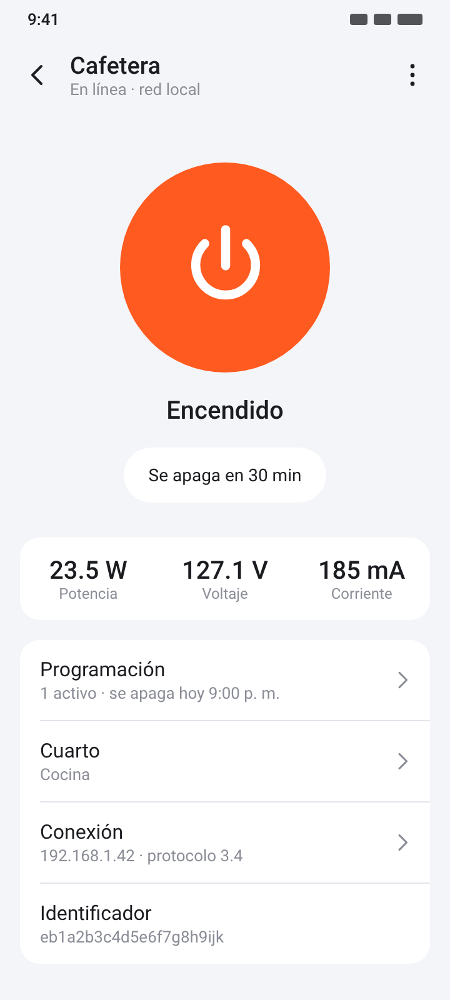
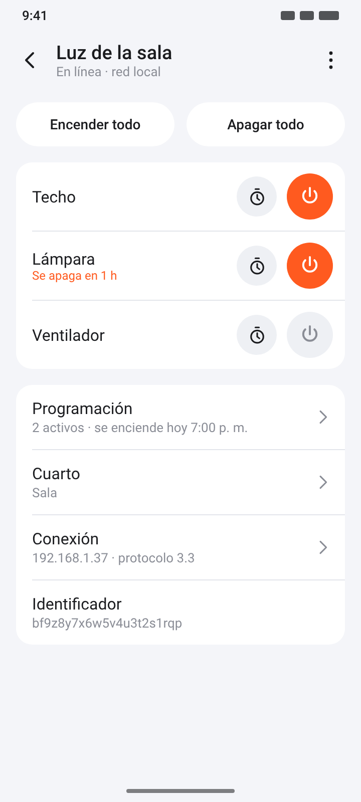
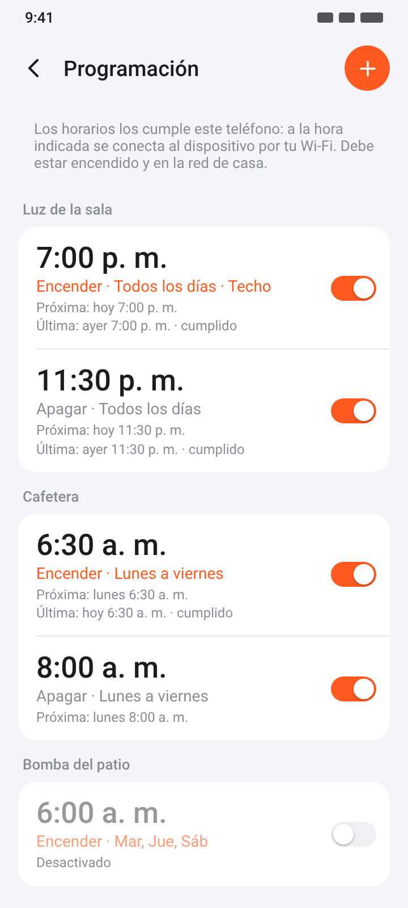
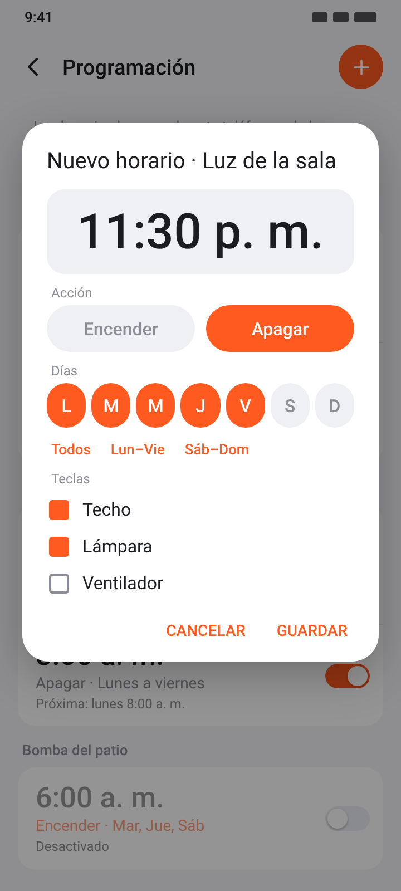
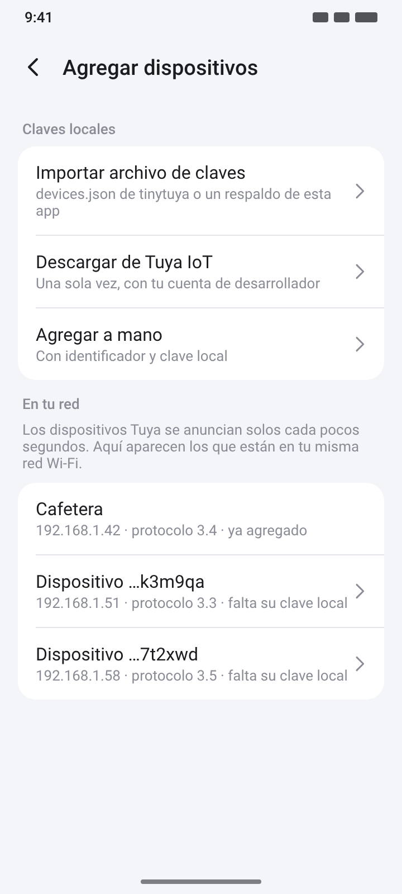
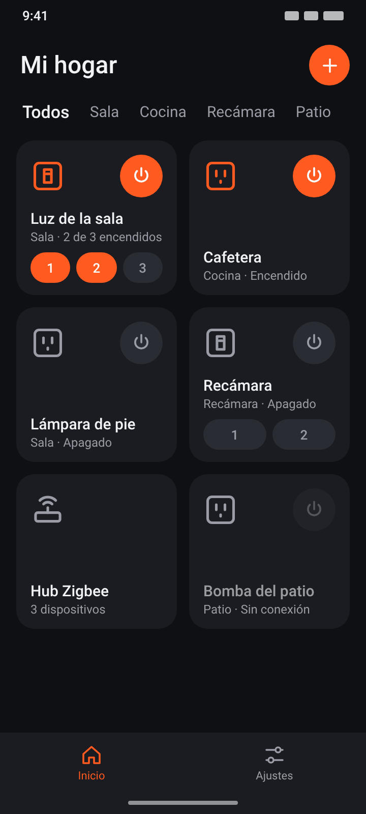

<p align="center"></p>

# Hogar Local

**Controla tus interruptores de pared y contactos inteligentes Tuya / Smart Life directamente por el Wi-Fi de tu casa.**
Sin cuenta, sin nube, sin rastreo, sin anuncios. Una app Android nativa de 90 KB.

<p align="center">
  <a href="https://github.com/web-gdl/tuya/raw/main/descargas/HogarLocal.apk"><b>⬇️ Descargar APK (v0.2.0, 90 KB)</b></a>
  ·
  <a href="descargas/SHA256SUMS.txt">SHA-256</a>
  ·
  <a href="LICENSE">Licencia: un regalo para la humanidad</a>
</p>

> Enlace fijo, siempre a la última versión:
> `https://github.com/web-gdl/tuya/raw/main/descargas/HogarLocal.apk`

---

## Galería

<p align="center">
  
  
  
  
</p>
<p align="center">
  
  
  
</p>

<sub>Las imágenes son ilustraciones generadas por <code>docs/preview/render.py</code> con las mismas medidas, colores e iconos que el código; no son capturas de un teléfono real.</sub>

## ¿Por qué existe?

La app oficial (Tuya Smart / Smart Life) pesa cientos de megas, exige cuenta, manda cada pulsación a servidores en la nube e incluye SDK de estadísticas y publicidad. Para encender una luz que está a cinco metros, nada de eso hace falta: los dispositivos Tuya ya saben recibir órdenes por la red local.

Hogar Local habla ese protocolo local directamente. Tu teléfono y tu interruptor, nadie en medio.

## Qué hace

| | |
|---|---|
| 🏠 **Inicio al estilo Smart Life** | Hogar, pestañas por cuarto y tarjetas con encendido rápido. Los interruptores de 2 a 6 teclas muestran un botón por tecla. |
| 💡 **Detalle del dispositivo** | Encendido, «encender / apagar todo», nombre por tecla y temporizador del propio dispositivo. |
| 📅 **Programación semanal** | Encender o apagar a una hora fija los días que elijas, por tecla. La cumple el teléfono, sin nube. [Guía](docs/PROGRAMACION.md) |
| ⚡ **Consumo** | Potencia (W), voltaje (V) y corriente en los contactos con medidor, actualizado cada 5 s. |
| 🔄 **Estado en vivo** | Si alguien pulsa el botón físico, la app lo ve al instante. |
| 🔍 **Detección automática** | Encuentra la IP y la versión del protocolo de cada dispositivo escuchando sus anuncios en la red. |
| 🧩 **Zigbee** | Subdispositivos a través de su hub Tuya *(experimental)*. |
| 🌙 **Tema oscuro** | Sigue el del sistema. |
| 💾 **Respaldo** | Exporta e importa todo en un archivo JSON. |

Protocolo local Tuya **3.1, 3.3, 3.4 y 3.5** (los que usan prácticamente todos los interruptores y contactos de los últimos años).

## Privacidad

- **Sin cuenta.** No hay registro ni inicio de sesión.
- **Sin nube para controlar.** Todas las órdenes van por tu red local (TCP 6668).
- **Sin telemetría, anuncios ni SDK de terceros.** Ni Firebase, ni Google, ni Tuya. Lo comprueba `audit.sh`.
- **Nada corriendo en segundo plano.** Sin servicios: las conexiones se abren al ver la app y se cierran al salir. La única excepción son tus horarios: si programas alguno, Android despierta la app unos segundos a esa hora para mandar la orden, y nada más.
- **Permisos:**
  - `INTERNET` — Android lo exige para cualquier conexión, incluso dentro de tu casa.
  - `CHANGE_WIFI_MULTICAST_STATE` — para escuchar los anuncios de los dispositivos en el Wi-Fi.
  - `USE_EXACT_ALARM` / `SCHEDULE_EXACT_ALARM` — para que los horarios se cumplan a la hora exacta.
  - `RECEIVE_BOOT_COMPLETED` — para reponer la alarma de los horarios al reiniciar el teléfono.
- El único acceso a internet es **opcional y lo inicias tú**: «Descargar de Tuya IoT», para obtener las claves una sola vez. Las credenciales no se guardan.

## Instalación

1. Descarga [`HogarLocal.apk`](https://github.com/web-gdl/tuya/raw/main/descargas/HogarLocal.apk) en tu teléfono (Android 8 o superior).
2. Ábrelo y permite «instalar apps desconocidas» para tu navegador o gestor de archivos.
3. Conecta el teléfono al **mismo Wi-Fi** que tus dispositivos.
4. Toca **+** y carga las claves locales (siguiente sección).

## Las claves locales

Cada dispositivo Tuya cifra su tráfico con una **clave local** de 16 caracteres que solo entrega la nube de Tuya. Se obtiene **una sola vez** por cualquiera de estas vías:

### A) Desde la app, con Tuya IoT (recomendado)

1. Crea una cuenta gratuita en [platform.tuya.com](https://platform.tuya.com) (iot.tuya.com).
2. **Cloud → Development → Create Cloud Project.** Elige el centro de datos de tu cuenta de Smart Life (para México: *Western America*).
3. En el proyecto: **Devices → Link App Account → Add App Account** y escanea el código QR desde Smart Life (*Yo → icono de escanear*).
4. Cierra el panel *Manage Devices* y, en la pestaña **Overview**, sección **Authorization Key**, copia el **Access ID** y el **Access Secret** (este último está oculto: pulsa el ojo o el icono de copiar).
5. En Hogar Local: **+ → Descargar de Tuya IoT**, elige el mismo centro de datos y pega las credenciales.

Se bajan nombres, claves y funciones de todos tus dispositivos.

📘 **Guía paso a paso, con tabla de centros de datos y solución de errores: [docs/CLAVES.md](docs/CLAVES.md).**

### B) Importar un archivo

El `devices.json` que genera [tinytuya](https://github.com/jasonacox/tinytuya) (`python -m tinytuya wizard`) o un respaldo de esta app: **+ → Importar archivo de claves**.

### C) A mano

**+ → Agregar a mano** con el identificador y la clave local. Los dispositivos que se anuncian en tu red aparecen en la sección «En tu red» con su identificador ya escrito.

> ⚠️ Si vuelves a emparejar un dispositivo en Smart Life, su clave local cambia y hay que importarla de nuevo.

## Límites

- **Solo en tu red.** No hay control fuera de casa (eso requeriría la nube).
- **No empareja dispositivos nuevos.** Eso se hace una vez con Smart Life; después puedes desinstalarla o dejarla.
- **Los horarios los cumple el teléfono.** Debe estar encendido y en el Wi-Fi de casa a esa hora, y sin ahorro de batería agresivo para la app ([detalles](docs/PROGRAMACION.md#requisitos-para-que-se-cumplan)).
- **Sin escenas** («tocar para ejecutar») todavía.
- **Conexiones simultáneas.** Muchos dispositivos aceptan pocas conexiones locales a la vez: si Smart Life está abierta al mismo tiempo, uno de los dos puede quedar sin conexión.
- **Zigbee por hub** está implementado pero sin probar en hardware.

## Estado del proyecto

Versión **0.2.0** — programación semanal de encendido y apagado.

- ✅ Compila, firma v2+v3 verificada (misma clave que la 0.1.0: se actualiza sin desinstalar).
- ✅ 273 pruebas automáticas contra un dispositivo simulado (las cuatro versiones del protocolo, hub, clave incorrecta, reconexión, nube simulada, importación, cálculo de horarios con cambio de horario, ejecución programada).
- ✅ Tramas comprobadas contra vectores generados aparte en Python.
- ⏳ **Pendiente de probar en teléfonos y dispositivos reales.** Si la pruebas, abre un *issue* con el modelo de tu dispositivo y lo que ves.

Historial de cambios: [CHANGELOG.md](CHANGELOG.md).

## Compilar

Sin Gradle, sin AndroidX, sin Kotlin. Solo el JDK (17 o superior) y tres archivos en `tools/`:

| Archivo | De dónde |
|---|---|
| `android.jar` | API 36 ([Sable/android-platforms](https://github.com/Sable/android-platforms)) |
| `aapt2` | Incluido en [Apktool](https://github.com/iBotPeaches/Apktool) (`prebuilt/linux/aapt2`) |
| `jadx-all.jar` | [jadx 1.5.1](https://github.com/skylot/jadx/releases) (aporta D8 y apksig) |

```sh
./build.sh   # aapt2 → javac → D8 → apksig  ⇒  out/HogarLocal.apk
./test.sh    # pruebas en la JVM contra un dispositivo Tuya simulado
./audit.sh   # permisos, componentes y destinos de red del APK
```

La primera compilación crea una clave de firma en `keystore/release.p12` (no se sube al repositorio). Consérvala: sin ella no se puede actualizar la app instalada.

## Estructura

```
src/app/hogarlocal/
├── proto/   Protocolo: tramas 55AA/6699, sesión con reconexión, descubrimiento UDP,
│            cliente de Tuya IoT y JSON mínimo (sin dependencias, corre también en la JVM)
├── model/   Dispositivos, significado de cada DP, almacenamiento e importación
├── sched/   Horarios semanales: cálculo de la siguiente ejecución y conexión de un solo uso
├── ui/      Inicio, detalle y alta de dispositivos, construidos en código
├── Home.java              Conexiones vivas mientras la app está en pantalla
├── Scheduler.java         Alarma del próximo horario
└── ScheduleReceiver.java  Cumple los horarios a su hora (único componente en segundo plano)
res/         Colores (claro/oscuro), estilos e iconos vectoriales
test/        Dispositivo simulado, vectores de referencia en Python y pruebas
docs/        Guías e imágenes (render.py las regenera)
descargas/   El APK firmado y su suma SHA-256
```

Detalle del protocolo: [docs/PROTOCOLO.md](docs/PROTOCOLO.md). Programación: [docs/PROGRAMACION.md](docs/PROGRAMACION.md).

## Agradecimientos

El protocolo local de Tuya fue descifrado y documentado por la comunidad. Este proyecto se apoyó en la documentación y el código de [tinytuya](https://github.com/jasonacox/tinytuya) (MIT) y [tuya-local](https://github.com/make-all/tuya-local) (MIT) para entender el formato; la implementación es propia y no copia su código.

La letra de las imágenes es Roboto (Apache 2.0).

*Hogar Local no está afiliado a Tuya Inc. «Tuya» y «Smart Life» son marcas de sus respectivos dueños; se mencionan solo para indicar con qué dispositivos es compatible.*

## Licencia

**Un regalo para la humanidad.** Este proyecto es de dominio público bajo [The Unlicense](LICENSE): úsalo, cópialo, modifícalo, véndelo o compártelo, para lo que quieras, sin pedir permiso.
