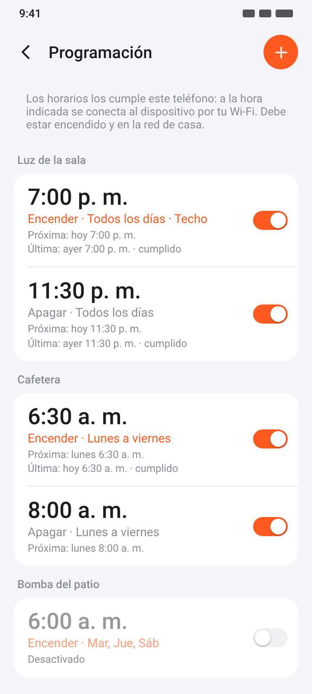
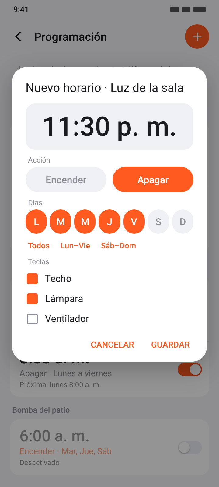

# Programación: encendido y apagado semanal

Desde la versión 0.2.0, Hogar Local puede encender o apagar tus dispositivos a una hora fija, los días de la semana que elijas. Por ejemplo:

- La luz del patio se enciende todos los días a las 7:00 p. m. y se apaga a las 11:30 p. m.
- La cafetera se enciende de lunes a viernes a las 6:30 a. m.
- En un interruptor de tres teclas, solo «Techo» y «Lámpara» se apagan a medianoche.

  
  

Ilustraciones generadas con las medidas del código, no capturas reales.

## Cómo se usa

**Para un dispositivo:** ábrelo y toca **Programación**. **Para todo el hogar:** **Ajustes → Programación** (se agrupan por dispositivo).

1. Toca **+**. Si estás en la vista de todo el hogar, primero elige el dispositivo.
2. Toca la hora grande para cambiarla.
3. Elige **Encender** o **Apagar**.
4. Marca los **días**. Atajos: *Todos*, *Lun–Vie*, *Sáb–Dom*.
5. En interruptores de varias teclas, elige **qué teclas**. Por defecto, todas.
6. **Guardar**. Un aviso te dice cuándo será la próxima vez.

En la lista:
- El **interruptor** de cada horario lo activa o desactiva sin borrarlo.
- **Tocar** un horario lo edita; **mantenerlo pulsado** lo elimina.
- Cada horario muestra la **próxima** ejecución y el resultado de la **última**: *cumplido*, *enviado, sin confirmar* o el motivo del fallo.

En el detalle del dispositivo, la fila *Programación* resume cuántos horarios hay activos y qué pasará después, por ejemplo: «2 activos · se apaga hoy 11:30 p. m.».

## Cómo funciona (y por qué así)

En los dispositivos Tuya, los horarios normales los cumple **la nube de Tuya**: el servidor manda la orden a la hora indicada. Si el dispositivo no tiene internet, no se cumplen. Algunos modelos guardan el horario en su memoria, pero ese horario se les carga desde la nube, no por la red local.

Como Hogar Local no usa la nube, **los horarios los cumple tu teléfono**:

1. La app deja puesta **una sola alarma** de Android, la del próximo horario.
2. A esa hora, Android despierta la app unos segundos aunque la pantalla esté apagada.
3. La app se conecta a los dispositivos por tu Wi-Fi, manda la orden, espera la confirmación, se desconecta y deja puesta la siguiente alarma.

No hay ningún servicio corriendo todo el tiempo: entre un horario y otro la app no hace nada.

## Requisitos para que se cumplan

- **El teléfono debe estar encendido y conectado al Wi-Fi de casa** a esa hora. Si estás fuera, el horario falla y queda anotado como *sin conexión*.
- **Ahorro de batería:** Android y, sobre todo, algunos fabricantes pueden dormir la app y retrasar o saltarse la alarma. En la pantalla de Programación aparece un aviso mientras la app tenga restricciones; tócalo para abrir sus ajustes:
  - **Batería → Sin restricciones** (o *No optimizar*).
  - **Xiaomi / HyperOS:** activa también **Inicio automático** en los ajustes de la app.
  - **Samsung:** quita la app de *Apps en suspensión* / *Apps en suspensión profunda*.
- **Alarmas exactas:** Android 12 y posteriores pueden pedir permiso para alarmas exactas. Si falta, la pantalla lo avisa y el horario puede retrasarse unos minutos.
- **Si el teléfono despierta con más de 30 minutos de retraso**, la orden ya no se manda (para no encender algo a deshoras) y queda anotado.
- **Smart Life abierta al mismo tiempo** puede ocupar la conexión local del dispositivo y hacer que el horario falle.

## Qué pasa si…

| Situación | Resultado |
|---|---|
| Reinicias el teléfono | La alarma se repone sola al encender. |
| Cambias la hora o la zona horaria | Se recalcula sola. |
| Hay cambio de horario de verano | Se respeta la hora local. Si la hora no existe ese día (por ejemplo 2:30 al adelantar el reloj), se cumple en cuanto el reloj la pasa. |
| Dos horarios a la misma hora | Se cumplen juntos, con una sola conexión por dispositivo o hub. |
| La app está abierta a esa hora | Usa la conexión que ya tiene abierta. |
| Borras un dispositivo | Se borran sus horarios. |
| Exportas un respaldo | Los horarios van incluidos y se restauran al importarlo. |
| Fuerzas la detención de la app | Android quita sus alarmas; se reponen al volver a abrirla. |

## Resultados posibles

| Texto | Significado |
|---|---|
| *cumplido* | El dispositivo confirmó el cambio. |
| *enviado, sin confirmar* | La orden salió, pero el dispositivo no avisó del cambio a tiempo. Casi siempre sí se cumplió. |
| *falló: sin conexión* | El teléfono no llegó al dispositivo: probablemente estaba fuera de casa o sin Wi-Fi. |
| *falló: no respondió* | El dispositivo no contestó; puede que Smart Life lo tuviera ocupado. |
| *falló: clave local incorrecta* | El dispositivo se volvió a emparejar; vuelve a importar las claves. |
| *no se envió: el teléfono despertó tarde* | Ver *Ahorro de batería*. |

## Detalles técnicos

- `sched/Planner.java` calcula la siguiente ejecución y qué reglas tocan en un minuto dado, con `java.time` en la zona del teléfono.
- `sched/Runner.java` hace la conexión de un solo uso, en paralelo por equipo o hub, con 15 s como máximo.
- `Scheduler.java` pone la alarma con `setExactAndAllowWhileIdle`, o `setAndAllowWhileIdle` si no hay permiso de alarmas exactas.
- `ScheduleReceiver.java` es el único componente que corre sin la app en pantalla. No está exportado: solo lo alcanzan la propia app y el sistema (alarma, arranque, cambio de hora y actualización de la app).
- Permisos añadidos:
  - `USE_EXACT_ALARM` (Android 13+) y `SCHEDULE_EXACT_ALARM` (solo Android 12): para despertar a la hora exacta.
  - `RECEIVE_BOOT_COMPLETED`: para reponer la alarma tras reiniciar.
- Los horarios se guardan en `hogar.json` (clave `schedules`): hora, días como máscara de bits (lunes = bit 0), acción, teclas y último resultado.
